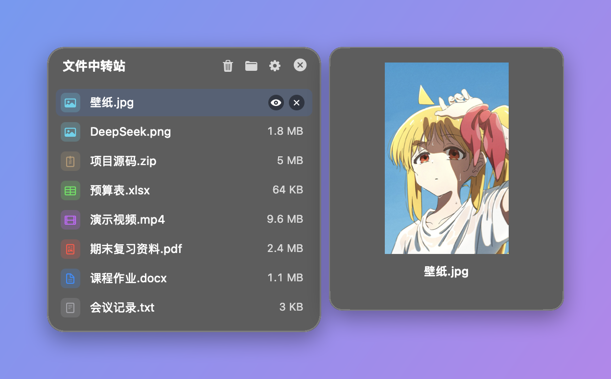

# Mac 文件中转站 (MacFileRelay)

<p align="center">
  <b>极简 · 原生 · 无感 · 极速的 macOS 摇晃拖拽文件中转站</b><br>
  <i>Ultra-lightweight, native macOS shake-to-drop file shelf & relay station.</i><br><br>
  <a href="https://github.com/Yux-c/MacFileRelay/releases/latest">
    
  </a>
  
  
  <a href="LICENSE"></a>
</p>

<p align="center">
  
</p>

---

## 中文介绍 (Chinese)

**Mac 文件中转站 (MacFileRelay)** 是一款使用苹果原生 **Swift 6 + AppKit** 构建的极轻量文件中转与暂存小工具。

### 核心亮点

1. **摇晃鼠标，就地中转**：
   - 拖拽任意文件时，在屏幕任何位置**轻轻左右晃动两下光标**，毛玻璃中转站立刻在鼠标旁就地展开！
   - 原地暂存、原地释放，无需特意拖到屏幕边缘或顶部。
2. **多文件连续暂存**：
   - 支持多次分批拖入文件，紧凑的单行列表：左侧按格式显示小图标（图片、PDF、视频、音频、压缩包、表格、文档、代码等），右侧显示大小，窗口高度随文件数自动伸缩。
   - 鼠标在图片上停留 1 秒，旁边浮出大图预览，移到其他图片即时切换；其他格式只在列表中显示（可在偏好设置中关闭预览）。
3. **固定数量自动轮换**：
   - 中转站默认最多保留 20 个文件（偏好设置中可调，范围 5–100），超出时最早存入的文件会**自动移入系统废纸篓**，随时可以恢复。
4. **极速拖出到微信/邮件/访达**：
   - 鼠标按住文件直接拖到聊天窗口、邮件或任意文件夹即可完成发送。
5. **空格秒级预览 (QuickLook)**：
   - 悬停文件按 `Space` 空格键或点击 `👁️` 眼睛图标，立即调出 macOS 原生 QuickLook 大图/音视频预览。
6. **极致轻量与省电**：
   - 零网页套壳，纯原生编译，待命时 **0.0% CPU**，内存仅十几 MB。

### 快捷操作

| 动作 | 方式 | 说明 |
| :--- | :--- | :--- |
| **就地唤出 / 立即关闭** | 拖拽文件时**摇晃鼠标** | 晃一下打开，再晃一下立刻秒关 |
| **快捷打开 / 隐藏** | **`⌥ + D`** (Option + D) | 随时在鼠标位置召唤或收起中转站 |
| **空格快速预览** | **`Space`** (空格键) 或点击 **`👁️`** | 调出 macOS 原生 QuickLook 预览 |
| **按住直接拖出** | 按住任意文件拖拽 | 直接拖出到微信、邮件或访达 |
| **偏好设置** | 点击右上角 **`⚙️`** 或按 **`⌘ + ,`** | 自定义语言、快捷键、灵敏度、最多保留文件数等 |
| **菜单栏管理** | 点击顶部菜单栏 **`📥`** 小图标 | 快速管理中转站 |

---

## English (Overview)

**MacFileRelay** is an ultra-fast, native macOS utility designed to make moving and organizing files frictionless.

### Key Features

- **Shake to Summon**: Simply shake your cursor while dragging files, and the relay shelf appears right next to your pointer.
- **Multi-File Shelf**: Drop multiple files at once or append over time; a compact one-line-per-file list with format icons and sizes that grows with its contents.
- **Image Hover Preview**: Rest the pointer on an image for a second to see a large preview beside the shelf; other files stay in the list.
- **Fixed-Size Rotation**: Keeps up to 20 files by default (adjustable from 5 to 100); when the shelf is full, the oldest files move to the macOS Trash.
- **Native QuickLook**: Spacebar preview for images, audio, video, PDFs, and code.
- **Native & Featherlight**: Built in pure Swift 6 + AppKit. 0.0% idle CPU and minimal RAM footprint.

---

## 编译与安装 (Build & Install)

```bash
# 1. Clone repository
git clone https://github.com/Yux-c/MacFileRelay.git
cd MacFileRelay

# 2. One-click build and install
chmod +x build.sh
./build.sh
```

---

## 开源协议 (License)

[MIT License](LICENSE) © 2026 MacFileRelay Authors.
